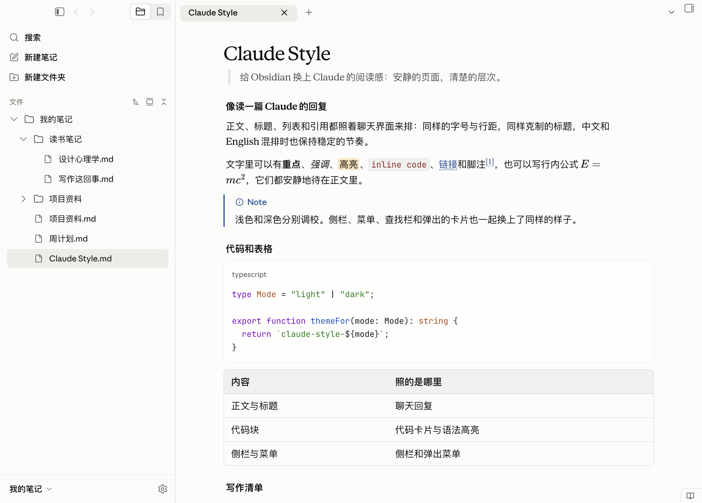
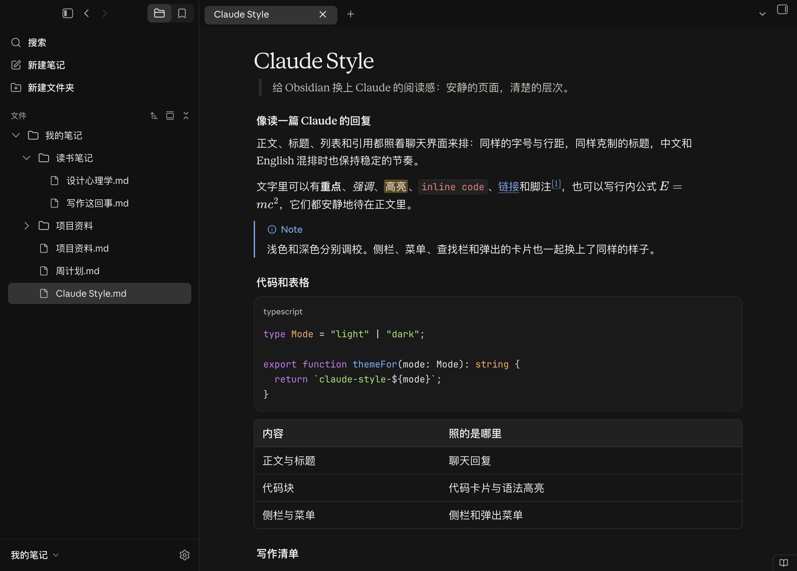
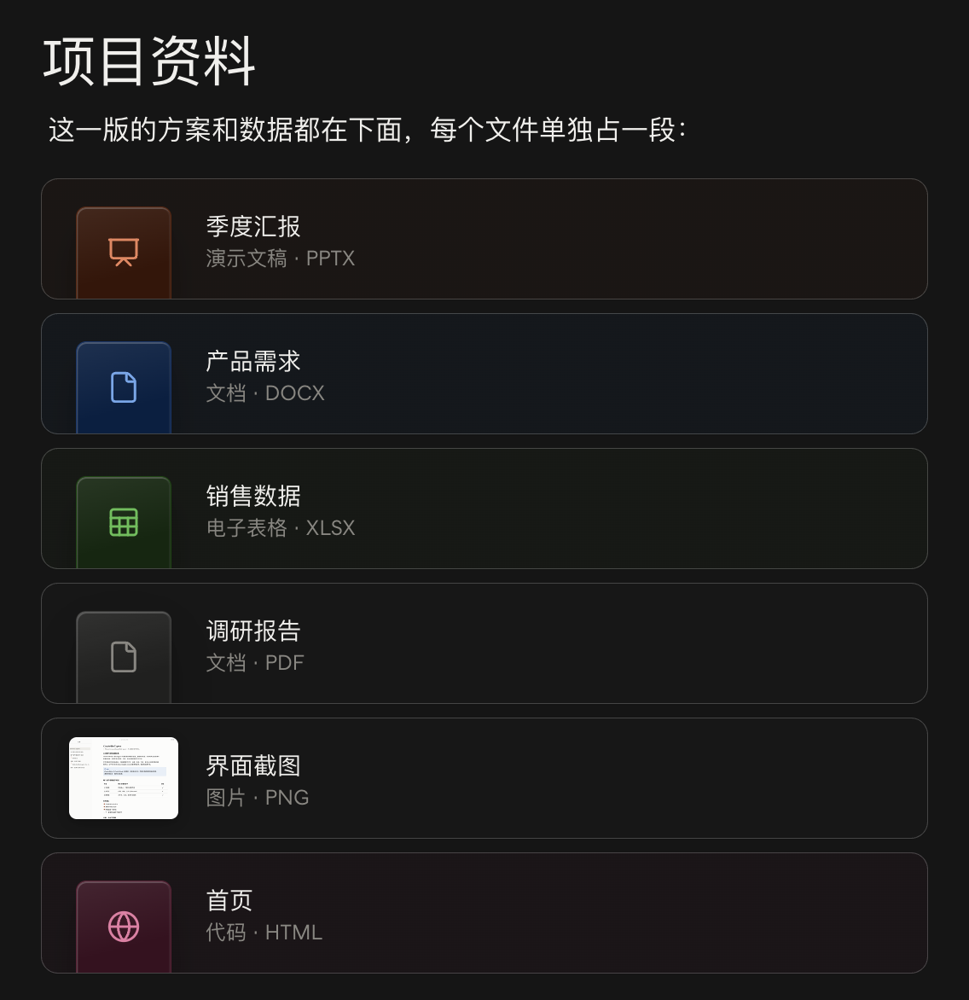

# Claude Style for Obsidian

English · [简体中文](README.zh-CN.md)

Claude's reading experience, brought to [Obsidian](https://obsidian.md).

Type and spacing, code cards and tables, callouts and file cards — all set the way Claude sets a reply. Obsidian's own interface follows suit: the sidebar, menus, command palette, find bar, dialogs and settings take on Claude's quiet, unhurried character. Light and dark live in one theme and follow Obsidian's colour setting.

The theme is complete on its own; see [Installation](#installation). To go a step further, pair it with the optional plugin [Claude Style Enhance](https://github.com/Xv-Bowen/Claude-Style-Obsidian-Enhance): live preview is laid out exactly like the reading view, so what you see as you write is what you will read; a file linked in a paragraph of its own becomes the card Claude shows for a shared file; the cursor and the language names on code blocks follow Claude too; and the sidebar gains a few of Claude's touches — a Search row, the vault's own folder, and back and forward at the top.

Live preview that matches the reading view, code blocks labelled with the language as written, and long blocks that carry on across pages in PDFs often take separate plugins in Obsidian; Claude Style and its plugin bring them along.

Claude Style is an independent theme. It is not made, endorsed or supported by Anthropic, and it contains no fonts, icons or other files from Anthropic. Claude is a trademark of Anthropic.

## Preview

### Light



### Dark



### File cards

With the plugin installed, files linked in paragraphs of their own, light and dark:




## Compatibility

Claude Style is carefully designed on the Mac and thoroughly tested on macOS, Windows and Linux.

It needs Obsidian 1.15 or later.

## Which version of the desktop app it follows

The desktop app's interface changes over time. Claude Style follows the new interface that came after version 3.1623 (version 3.6556). A later, smaller update (version 4.23118) gave replies wider line spacing when the interface is in Chinese, Japanese or Korean, and heavier bold text; Claude Style follows both. The same update set the Chinese in replies in Songti when the reply font is serif; Claude Style does not follow that, and keeps PingFang for Chinese.

**Why it does not follow the new interface in everything**

The new interface has not been well received, and many people reacted strongly to it. It changed more than sizes and layout: it also changed the colours and several everyday parts. Secondary text and dividing lines are fainter, most of all in dark mode; inline code is no longer red and has lost its border; tables have lost their border and the header's fill; and file cards have become one-line rows with a small icon on the left. Together these make a document harder to read than before.

So Claude Style follows only the new interface's frame: its sizes, spacing, layout and icons. The colours and the parts below keep the look from before the new interface:

- **Colours**: the earlier colours, with clearer text and dividing lines. The only colour taken from the new interface is the text in the sidebar, where the new interface uses a darker colour.
- **Tables**: the border, the rounded corners and the header's fill stay, so rows and columns are easier to follow.
- **Inline code**: the red text and the thin border stay, so code stands apart from the text more clearly.
- **File cards**: the cards stay coloured by the kind of file, so you can tell what a file is at a glance.

**How Claude Style is designed**

Claude Style aims to make notes in Obsidian read like a reply in Claude, so wherever it can, it follows the desktop app instead of inventing its own look; but it follows the app so that notes read comfortably, not to copy it pixel for pixel. Where a change in the new interface makes documents harder to read, Claude Style does not take it. Parts that Claude does not have (the graph, canvas, tabs, bases and so on) are drawn in the same style, with Claude's colours and ways.

## Installation

### From within Obsidian

1. Open **Settings → Appearance**, select **Manage** next to Themes, search for **Claude Style**, then install and use it.
2. The plugin is installed on its own: in Obsidian, themes and plugins are installed separately, and installing the theme does not bring the plugin along. Open **Settings → Community plugins**, turn off **Restricted mode**, select **Browse** next to Community plugins, search for **Claude Style Enhance**, install it and enable it.

### By hand

1. Download `claude-style-obsidian-<version>.zip` from the [latest release](https://github.com/Xv-Bowen/Claude-Style-Obsidian/releases/latest) and unzip it. It holds two folders, `themes` and `plugins`, so the theme and the plugin come together.
2. Open your vault's folder and go into its `.obsidian` folder (it is hidden; in the Mac's Finder, press ⇧⌘. to show hidden files).
3. Put the `Claude Style` folder from `themes` into `.obsidian/themes`, and the `claude-style-enhance` folder from `plugins` into `.obsidian/plugins`. Create either folder if it is not there.
4. Reopen Obsidian. Choose **Claude Style** under Themes in **Settings → Appearance**; in **Settings → Community plugins**, turn off **Restricted mode** and enable **Claude Style Enhance**.

For the theme alone, you can also download just `theme.css` and `manifest.json` from the release and put them in `.obsidian/themes/Claude Style/`.

### On the Mac

Turn off **Native menus** in **Settings → Appearance**. On the Mac, Obsidian uses the system's own menus by default (the right-click menus, the tab menus and so on), which a theme cannot change; with the setting off, these menus take the theme's Claude look.

### Settings you may want to change

These are Obsidian's own settings; set them as you like:

- **The items at the bottom right of the status bar**: in **Settings → Core plugins**, turn off Word count (words and characters), Backlinks (the backlinks panel in the right sidebar goes too), Properties view (the panel listing the vault's properties goes too; the properties at the top of a note stay) and Show editing mode in status bar (the button that switches between editing and reading).
- **The ribbon on the far left**: turn off Show ribbon in **Settings → Appearance**, or right-click an empty part of the ribbon and choose Hide ribbon.
- **Zooming in a canvas**: by default, scrolling with ⌘ held down (Ctrl on Windows and Linux) zooms, and scrolling alone moves the canvas. To zoom with the wheel alone, set Default mouse wheel behavior to Zoom in the Canvas settings.

The author's own settings, for reference: in **Settings → Appearance**, Show tab title bar, Show ribbon and Native menus are off; in **Settings → Core plugins**, Backlinks, Word count and Sync are off, and Slash commands is on (type / in the editor to bring up commands). These are just the author's habits; the theme does not need them, except that on the Mac Native menus has to be off to see the theme's menus. The previews above were taken with these settings.

## What it covers

| Part | What you get |
| --- | --- |
| Reading | Claude's type sizes, line spacing and heading levels; the width of the text and the space on either side follow Claude's replies; when the interface is in Chinese, Japanese or Korean, the line spacing widens as it does in Claude; links, quotes, lists, tables, key caps, task lists and footnotes look as they do in Claude |
| Live preview | Quote bars and quoted text, and the continuation lines of lists, sit where they do in the reading view; tables span the text width, and long web addresses wrap inside their cells. With the plugin, live preview is laid out exactly like the reading view: the space between blocks (however many blank lines are written between them, or none), and code blocks, quotes and continuation lines in lists, all line up with the reading view. The 81 ways of putting one of 9 kinds of block (paragraph, three levels of heading — first, second, third and below —, list, table, horizontal rule, code block and quote) after another were each measured against the reading view, as were blocks written with no blank line between them and the many ways of writing lists; with blank lines folded away, the up and down arrow keys still move one line at a time |
| Code | Claude's code cards, with a language label and Claude's syntax colours; the copy button at the card's top right stays in view down a long block; code without a language wraps; inline code looks as it does in Claude. With the plugin, the label shows the language as written in the code block (`js` stays js), for any language, in live preview too |
| Cursor | With the plugin, the cursor in the editor is drawn the way Claude draws it: rounded, thicker than the system's, and it starts blinking again whenever it moves |
| Maths | The same size as in Claude. With the plugin, an inline formula that reaches the end of a line breaks after a sign such as = or +, as in Claude, not before it |
| Callouts | note, tip, important, warning and caution look as Claude shows alerts in a document: a coloured bar on the left and a coloured title with an icon on the first line. Obsidian's other kinds of callout look the same, in the Claude colour that fits their meaning |
| Diagrams | Mermaid diagrams use the colours Claude draws diagrams in |
| File links | With the plugin, a file linked in a paragraph of its own becomes the card Claude shows for a file it shares: a colour and icon for the kind of file, the file's name, and its kind and extension below; picture files show a thumbnail. Clicking a card opens the file. A file link inside a sentence, or a link to a web page or to part of a file, stays a link |
| Sidebar | The file list looks like Claude's sidebar: file names with their extensions, and names too long to fit fading out at the end; a folder you drag a file onto is outlined with Claude's focus ring; the vault's name at the bottom opens the menu for switching vaults. With the plugin, back and forward buttons sit at the top of the sidebar, a Search row sits above the file list, and a row for the vault's own folder heads the list (click it to fold the whole list) |
| Command palette and quick switcher | Like Claude's search: a card floating in the middle of the window, with the rest of the window dimmed; matched text in bold; each command shows its shortcut |
| Find | The find and replace bar, in notes and in PDFs, is a card at the top right of the page, as in Claude; matches in a note are marked in highlighter colour |
| Menus, dialogs and tips | Menus, dialogs, notices and tooltips look as they do in Claude; toggles and sliders follow Claude's |
| Settings | The Settings window follows Claude's settings page |
| Other views | Tabs, the status bar, the graph, canvas, note properties and bases take Claude's colours and look; the title at the top of the window uses the same type as a note's title bar |
| PDF export | The same styles as the reading view. A heading does not end up alone at the bottom of a page, and a table row is not split across pages; a long code block, quote or callout carries on onto the next page instead of moving down whole and leaving half a page empty, with more than a line or two on each side; wide tables wrap at word breaks and print in full on the page; a picture taller than a page is scaled to fit one |
| Motion | Only what moves in Claude moves; everything else changes at once |

Apart from what is marked "with the plugin", the table describes the theme on its own.

### Fonts

The theme uses these fonts when they are installed, and falls back in order when they are not:

| For | First choice | Then |
| --- | --- | --- |
| Text | Anthropic Serif | Times New Roman; Chinese in PingFang (Microsoft YaHei on Windows) |
| Interface | Anthropic Sans | The system font; Chinese in PingFang (Microsoft YaHei on Windows) |
| Code | JetBrains Mono NL | JetBrains Mono, Anthropic Mono, SF Mono, Menlo; Chinese in PingFang (Microsoft YaHei on Windows) |

The theme neither includes nor downloads any font, and Anthropic's fonts are not distributed with it. [JetBrains Mono](https://www.jetbrains.com/lp/mono/) is free to install. Fonts you set under Font in **Settings → Appearance** (interface, text or monospace) take the place of these.

### Icons

The icons in the interface are Obsidian's own; the theme only changes their colour, size and place, with their size matched to Claude's icons. The icons on file cards, the folder and file icons in the file list and the small arrow after the vault's name are drawn by the theme, from [Lucide](https://lucide.dev) (see [License](#license)). Claude's icons belong to Anthropic and cannot be distributed with a theme, so this theme does not use them.

### Printing and PDF

Obsidian always exports PDFs in light mode, on white pages, and they print as the reading view looks; file cards in a PDF have no shadow. Code cannot scroll sideways in a PDF, so long lines of code wrap. A long code block, quote or callout carries on onto the next page, and each part keeps its own border.

## The plugin (optional)

Without the plugin, none of the theme's look is lost. A theme can only change how Obsidian looks, and a few things need code; the optional plugin, Claude Style Enhance, adds those. The cards, buttons and rows are drawn by the theme; the plugin only finds where they belong and puts them there:

- **Live preview laid out like the reading view**: the plugin reads what each block of a note is and what comes before and after it, and the theme spaces them as the reading view does. Blank lines in the source fold away, and blocks are spaced only by Claude's spacing, however many blank lines there are; blocks with no blank line between them are spaced as in the reading view too. Code blocks in lists move under the item's text, without the list's indent inside the code; quotes and continuation lines in lists line up with the item's text. A folded blank line opens up when the cursor is on it, so you can type there, and the up and down arrow keys still move one line at a time. The blank lines and text of your note stay as they are; only how they show changes. Only the lines around a change are read again, so typing stays quick in long notes.
- **Code block language names**: shown as written in the code block, the same in the reading view, live preview and exported PDFs, for any language.
- **Line breaks in inline maths**: a formula that reaches the end of a line breaks after a sign such as = or +, as in Claude (`E =` stays at the end of the line and `mc²` starts the next), not before it.
- **The cursor**: the cursor in the editor is drawn the way Claude draws it.
- **File cards**: a file linked in a paragraph of its own becomes a card, in the reading view and in live preview. The card shows the file's name without its extension, with `_` and `-` turned into spaces (`Q3_report-final.pptx` shows as "Q3 report final"); picture files show a thumbnail. Clicking a card opens the file, and ⌘-clicking (Ctrl-clicking on Windows and Linux) opens it in a new tab. In live preview, the card turns back into the link when the cursor moves onto its line, so you can edit it.
- **A Search row**: a Search row above the file list, as at the top of Claude's sidebar, opens Obsidian's search; the switch at the top of the sidebar then leaves search out.
- **The vault's own folder**: a row with the vault's name heads the file list; clicking it folds and unfolds the whole list.
- **Back and forward**: next to the button that hides the sidebar, as in Claude; when the sidebar is hidden, they move with that button into the tab bar.
- **The vault menu**: opens above the vault's name, as Claude's account menu does, rather than where you clicked.

The plugin does not use the network and does not change your notes; with another theme, it does nothing. It shares the theme's version number. See [Installation](#installation) to install it, and [its own repository](https://github.com/Xv-Bowen/Claude-Style-Obsidian-Enhance) for more.

## Questions you may have

### Choices made on purpose

**Why is an unticked subtask crossed out?**\
Claude does the same: once a task is ticked, the whole item greys and is crossed out, the tasks under it included. The subtask's own box stays unticked.

**Why are lines spaced wider with the interface in Chinese?**\
Claude does the same: when its interface is in Chinese, Japanese or Korean, replies are spaced a little wider than with other interface languages, whatever language the reply is in. Claude Style follows Obsidian's interface language in the same way.

**Why does a file link on its own line in a quote not become a card?**\
In live preview each line of a quote starts with `>`, so the plugin cannot tell that the link stands alone; if the reading view drew a card there and live preview did not, the card would come and go as you switch views. So file links in quotes and callouts stay links in both views. File links in lists and tables stay links too, as Claude draws no cards there either.

### What a theme cannot do

Obsidian and the system work this way, and a theme can only change how things look.

**Why do the right-click menus keep the system look?**\
On the Mac, Obsidian uses the system's own menus by default; macOS draws them, and a theme cannot change them. Turn off Native menus in **Settings → Appearance**, and the menus take the theme's look.

**Why does the sidebar not show the desktop through it, as macOS's Liquid Glass does?**\
Obsidian's Translucent window setting uses macOS's frosted glass, which the theme leaves as Obsidian draws it. Liquid Glass is a different material, which Obsidian itself would have to ask the system for; a theme cannot make it.

**Why do some code blocks have no language label?**\
With the theme alone, a few dozen common languages get a label; a code block in a rarer language shows no label, and its code shows as usual. With the plugin, every language gets one.

**Why is the text cursor no thicker?**\
With the theme alone, Obsidian draws the cursor, and a theme can only change its colour. With the plugin, the cursor is drawn the way Claude draws it.

**Why is the spacing in live preview not the same as in the reading view?**\
With the theme alone, each blank line in live preview takes a full line, and a theme cannot tell which two blocks a blank line sits between, so it cannot fold it away as the reading view does. With the plugin, the two views are the same.

**Why is a table written right under a horizontal rule or a code block not a table in live preview?**\
When a table follows a horizontal rule or a code block with no blank line between them, the reading view sees a table, but Obsidian's live preview does not and shows it as text. Leave a blank line above the table, and it is a table in both views.

**Why do some rare characters show as boxes?**\
The theme includes no fonts. A character that none of the installed fonts has, such as 𠀀 (U+20000), shows as a box with any theme. Installing a font that has it makes it show.

### Known problems

None known yet. If something does not look right, please [open an issue](https://github.com/Xv-Bowen/Claude-Style-Obsidian/issues).

### Versions

**How are versions numbered?**\
Versions read 1.〈interface〉.〈release〉: the 2 in the middle says the theme follows the desktop app's new interface, and the last number counts releases in order. The theme and the plugin share one version number.

## Customization

You can change the fonts under Font in **Settings → Appearance**. For anything else, use an Obsidian CSS snippet: put a `.css` file in your vault's `.obsidian/snippets` folder and turn it on under CSS snippets in **Settings → Appearance**. Snippets load after the theme, so the theme file stays as it is. For example, a wider page:

```css
body {
  --file-line-width: 840px;
}
```

## Feedback

Found something that does not look right? Please [open an issue](https://github.com/Xv-Bowen/Claude-Style-Obsidian/issues) with a screenshot, your Obsidian version and your system (macOS, Windows or Linux, and its version).

## License

Claude Style is licensed under [Creative Commons Attribution-NonCommercial-NoDerivatives 4.0 International](LICENSE) (CC BY-NC-ND 4.0).

- You may use it and share unchanged copies, for non-commercial purposes, with credit to the author.
- You may not share changed versions of it, or use it commercially.
- Adjusting it for your own use with CSS snippets (see [Customization](#customization)) is fine.

The few icons the theme draws itself come from [Lucide](https://lucide.dev) (ISC License; code, database and chevron-down among them come from Feather, MIT License), under their own licences, which are reproduced at the end of [LICENSE](LICENSE).

For anything else, please ask the author.
