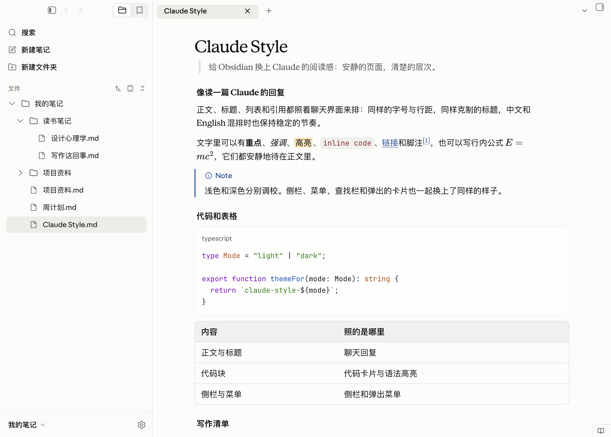
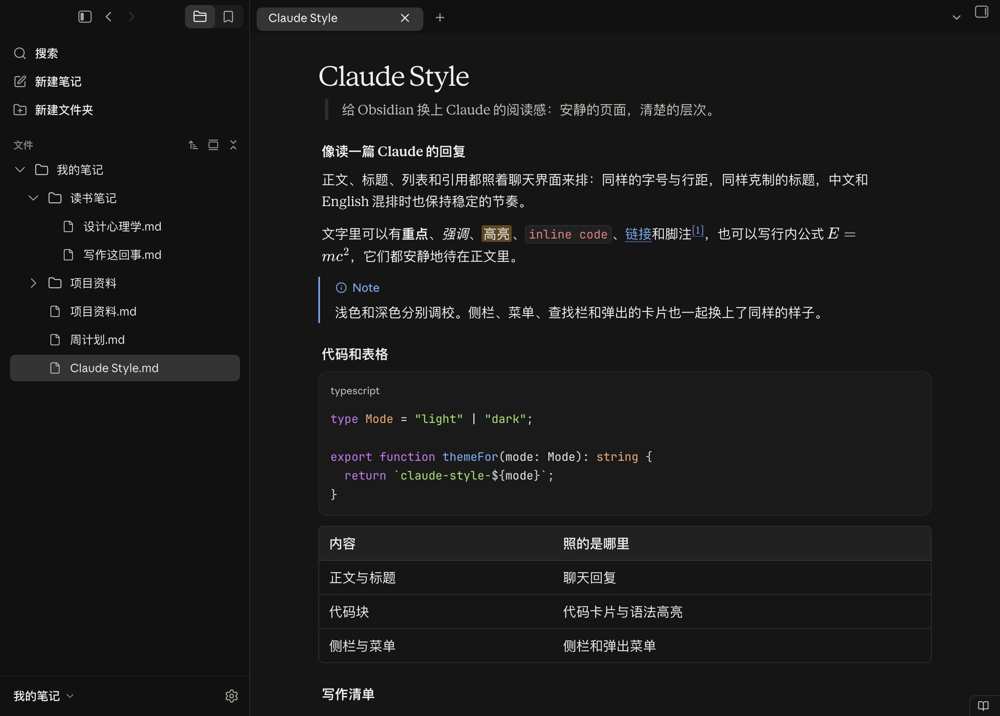
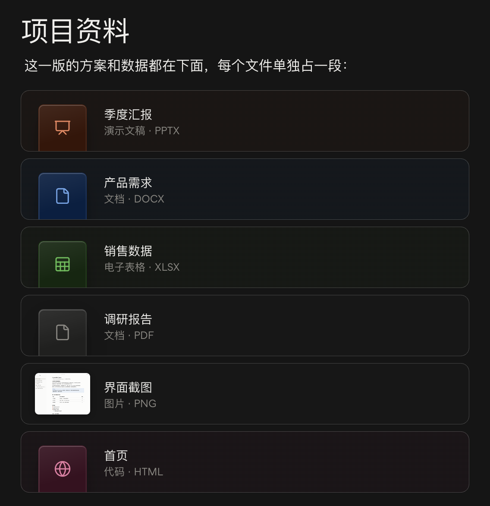

# Claude Style for Obsidian

[English](README.md) · 简体中文

把 Claude 的阅读感，带进 [Obsidian](https://obsidian.md)。

字号与行距，代码卡片与表格，提示框与文件卡片，都照 Claude 排一篇回复的方式来排。Obsidian 自己的界面也一并换了装：侧栏、菜单、命令面板、查找栏、对话框和设置，处处是 Claude 那份安静与克制。浅色与深色同在一个主题里，随 Obsidian 的颜色设置切换。

主题本身就是完整的，装上即用（见[安装](#安装)）。想再进一步，可以配上增强插件 [Claude Style Enhance](https://github.com/Xv-Bowen/Claude-Style-Obsidian-Enhance)：实时预览会排得和阅读视图一模一样，边写边看到的，就是读的时候的样子；单独成段的文件链接会化作 Claude 分享文件时的卡片；光标和代码块的语言名也照 Claude；侧栏补齐 Claude 的几处细节——"搜索"一行、库的根文件夹，还有侧栏顶上的后退与前进。

实时预览和阅读视图一模一样、代码块照写的原样标出语言、导出 PDF 时长内容接着排到下一页，这几样在 Obsidian 里往往要另装插件才有；Claude Style 和它的增强插件自己就带着。

Claude Style 是独立制作的主题，不是 Anthropic 出品，也没有得到 Anthropic 的认可或支持；主题里不含 Anthropic 的字体、图标或其他文件。Claude 是 Anthropic 的商标。

## 预览

### 浅色



### 深色



### 文件卡片

装了增强插件时，单独成段的文件链接显示成卡片，浅色和深色：




## 适用环境

Claude Style 在 Mac 上精心设计，在 macOS、Windows 和 Linux 上全面测试。

需要 Obsidian 1.15 或更新的版本。

## 照的是哪一版桌面应用

桌面应用的界面会更新。Claude Style 照的是 3.1623 版之后推出的新界面（3.6556 版）。之后的小更新里（4.23118 版），界面是中文、日文、韩文时回复的行距加宽了，粗体也更粗，Claude Style 跟着改了；同一次更新里，回复字体选衬线时中文改用宋体，这一处没有跟，中文仍用苹方。

**为什么没有全盘照新界面**

新界面推出以后，接受度普遍不高，不少用户的反应比较强烈。它不只是换了尺寸和布局，还改了颜色和几样常用的部件：次要的文字和分隔线都更淡，深色模式下尤其明显；行内代码不再是红字，也没了边框；表格去掉了外框和表头的底色；文件卡片换成了一行一张、左边一个小图标的样式。这些改动让文档读起来不如以前清楚。

所以 Claude Style 只照新界面的骨架：尺寸、间距、布局和图标。颜色和下面几样部件保留新界面推出以前的样子：

- **颜色**：保留原来的配色，文字和分隔线都更清楚。唯一照新界面改的是侧栏里的文字，因为新界面在这一处用了更深的颜色。
- **表格**：保留外框、圆角和表头的底色，行和列更容易看清。
- **行内代码**：保留红字和细边框，代码和正文分得更清楚。
- **文件卡片**：保留按文件类型着色的卡片，一眼就能认出是什么文件。

**设计理念**

Claude Style 想让 Obsidian 里的笔记读起来像 Claude 里的一篇回复，所以能照桌面应用的地方都照着做，不另起炉灶；但照着做是为了读得舒服，不是为了一模一样。新界面里让文档变难读的改动，Claude Style 不跟。Claude 里没有的部分（关系图谱、白板、标签页、数据库等），照 Claude 的颜色和做法画成同一种风格。

## 安装

### 在 Obsidian 里安装

1. 打开 **设置 → 外观**，在"主题"一栏点 **管理**，搜索 **Claude Style**，安装并使用。
2. 想要增强插件，要另外装：主题和插件在 Obsidian 里是分开装的，装主题不会连带装上插件。打开 **设置 → 第三方插件**，关掉 **安全模式**，在"社区插件市场"一栏点 **浏览**，搜索 **Claude Style Enhance**，安装后启用。

### 手动安装

1. 从[最新发布](https://github.com/Xv-Bowen/Claude-Style-Obsidian/releases/latest)下载 `claude-style-obsidian-<版本号>.zip` 并解压，里面有 `themes` 和 `plugins` 两个文件夹，主题和插件一次装齐。
2. 打开你的库所在的文件夹，进到里面的 `.obsidian` 文件夹（它是隐藏的，在 Mac 的访达里按 ⇧⌘. 显示隐藏文件）。
3. 把 `themes` 里的 `Claude Style` 文件夹放进 `.obsidian/themes`，把 `plugins` 里的 `claude-style-enhance` 文件夹放进 `.obsidian/plugins`；没有这两个文件夹就新建。
4. 重新打开 Obsidian，在 **设置 → 外观** 的"主题"里选 **Claude Style**；在 **设置 → 第三方插件** 里关掉 **安全模式**，启用 **Claude Style Enhance**。

只想要主题，也可以只下载发布里的 `theme.css` 和 `manifest.json`，放进 `.obsidian/themes/Claude Style/`。

### 用在 Mac 上时

在 **设置 → 外观** 里关掉 **原生菜单**。Obsidian 在 Mac 上默认用系统自己的菜单（右键菜单、标签页的菜单等），主题改不了；关掉以后，这些菜单才是主题画的 Claude 的样子。

### 可以自己调的设置

下面这些是 Obsidian 自己的设置，按自己的习惯来：

- **状态栏右下角的几项**：在 **设置 → 核心插件** 里关掉"字数统计"（字数和字符数）、"反向链接"（右侧栏的反向链接面板会一起关掉）、"属性列表"（列出整个库的属性的面板会一起关掉，笔记顶上的属性不受影响）、"视图状态"（切换编辑和阅读视图的按钮）。
- **最左边那列功能区**：在 **设置 → 外观** 里关掉"显示功能区"，或者在功能区的空白处右键，选"隐藏功能区"。
- **白板里放大缩小**：默认按住 ⌘（Windows 和 Linux 上是 Ctrl）再滚滚轮是缩放，直接滚轮是移动白板。想直接用滚轮缩放，在白板的设置里把"默认鼠标滚轮行为"改成"缩放"。

作者自己用的设置，供参考：在 **设置 → 外观** 里关掉"显示标签页标题栏""显示功能区"和"原生菜单"；在 **设置 → 核心插件** 里关掉"反向链接""字数统计"和"同步"，打开"斜杠命令"（在编辑器里输入 / 调出命令）。这些只是作者的习惯，用这个主题并不需要这样设；只有"原生菜单"那一项，在 Mac 上要关掉才看得到主题画的菜单。预览图就是用这套设置截的。

## 包括哪些部分

| 部分 | 效果 |
| --- | --- |
| 阅读 | Claude 的字号、行距和标题层级；正文的宽度和左右留白照 Claude 的回复；界面是中文、日文、韩文时行距照 Claude 加宽；链接、引用、列表、表格、键帽、任务列表和脚注都照 Claude 的样子 |
| 实时预览 | 引用的竖线和文字、列表的续行，摆在和阅读视图一样的位置；表格占满正文宽，格子里的长网址会换行。装了增强插件，实时预览排得和阅读视图一模一样：块和块之间的距离（不管中间空了几行，还是一行没空），列表里的代码块、引用和续行，都和阅读视图对齐。段落、三种标题（一级、二级、三级及以下）、列表、表格、分隔线、代码块、引用这 9 种块两两相接的 81 种组合，都逐一和阅读视图量过，中间一行没空的写法和列表里的各种写法也量过；空行收起来以后，上下方向键照样一行一行走 |
| 代码 | Claude 的代码卡片，带语言标签和 Claude 的语法高亮；复制按钮在卡片的右上角，读长代码时一直留在看得见的地方；没标语言的代码自动换行；行内代码也照 Claude 的样子。装了增强插件，语言标签照代码块里写的原样显示（写 `js` 就是 js），什么语言都有，实时预览也一样 |
| 光标 | 装了增强插件，编辑器里的光标照 Claude 的样子画：圆头，比系统的光标粗，移动时重新开始闪 |
| 公式 | 和 Claude 里一样大。装了增强插件，行内公式碰到行尾时照 Claude 在等号、加号这类符号后面换行，不在它们前面断开 |
| callout | note、tip、important、warning、caution 照 Claude 显示文档时提示框的样子：左边一条彩色竖线，第一行是带图标的彩色标题。Obsidian 其他种类的 callout 样子相同，按意思配上 Claude 的颜色 |
| 图表 | Mermaid 图表用 Claude 画图表时的颜色 |
| 文件链接 | 装了增强插件时，单独成段的文件链接显示成 Claude 分享文件时的卡片：按文件类型配颜色和图标，写着文件名，下面是类型和扩展名；图片文件的卡片带缩略图。点卡片打开文件。写在句子里的文件链接、指向网页或文件里某一部分的链接仍是链接 |
| 侧栏 | 文件列表照 Claude 侧栏的样子：文件名带上扩展名，放不下的名字在末尾淡出；把文件拖到文件夹上时，文件夹用 Claude 的焦点框圈出来；底部写着库名，点它打开切换库的菜单。装了增强插件，侧栏顶上多了后退和前进键，文件列表上面多了"搜索"一行，最上面多了库的根文件夹那一行（点它收起整个列表） |
| 命令面板和快速切换 | 照 Claude 的搜索：一张浮在窗口中间的卡片，窗口其余部分压暗；匹配的字加粗；每条命令后面写着它的快捷键 |
| 查找 | 笔记和 PDF 里的查找替换栏是页面右上角的一张卡片，和 Claude 的查找栏一样；笔记里找到的地方铺上荧光笔的颜色 |
| 菜单、对话框和提示 | 菜单、对话框、通知和提示气泡照 Claude 的样子；开关和滑块照 Claude 的开关和滑块 |
| 设置 | 设置窗口照 Claude 设置页的样子 |
| 其他视图 | 标签页、状态栏、关系图谱、白板、笔记属性和数据库，都换上 Claude 的颜色和样子；窗口顶上的标题和笔记的标题栏同一种字 |
| 导出 PDF | 和阅读视图同一套样式。标题不会单独落在一页的最下面，表格的一行不会被拆到两页；很长的代码块、引用和提示框接着印到下一页，不再整块挪走、留下半页空白，拆开的两段各有几行，不会只剩一两行；很宽的表格按词换行，整张印进页面；比一页还高的图片缩到一页之内 |
| 动效 | 只有 Claude 里会动的地方才动，其余都是即时变化 |

除了注明"装了增强插件"的地方，表里写的都是只装主题时的效果。

### 字体

装了下面的字体就用它们，没装就按顺序往后用：

| 用于 | 首选 | 依次回退到 |
| --- | --- | --- |
| 正文 | Anthropic Serif | Times New Roman，中文用苹方（Windows 上是微软雅黑） |
| 界面 | Anthropic Sans | 系统字体，中文用苹方（Windows 上是微软雅黑） |
| 代码 | JetBrains Mono NL | JetBrains Mono、Anthropic Mono、SF Mono、Menlo，中文用苹方（Windows 上是微软雅黑） |

主题不附带、也不下载任何字体，Anthropic 的字体不随主题分发。[JetBrains Mono](https://www.jetbrains.com/lp/mono/) 可以免费安装。在 **设置 → 外观** 的"字体"里填了界面字体、正文字体或等宽字体，就用你填的。

### 图标

界面上的图标都是 Obsidian 自带的，主题只调整它们的颜色、大小和位置，大小调到和 Claude 的图标一样。文件卡片上的图标、文件列表里文件夹和文件的图标、库名后面的小箭头是主题自己画的，取自 [Lucide](https://lucide.dev)（见[许可证](#许可证)）。Claude 的图标属于 Anthropic，不能随主题分发，所以这套主题没有使用 Claude 的图标。

### 打印和 PDF

导出 PDF 时，Obsidian 一律用浅色，页面是白色的，印出来的样子和阅读视图一样；文件卡片在 PDF 里不带阴影。代码在 PDF 里没法横向滚动，长代码行会换行。很长的代码块、引用和提示框会接着印到下一页，拆开的两段各自带着边框。

## 增强插件（可选）

不装增强插件，主题的样子一样不少，照常使用。主题能改的只有 Obsidian 的外观，有几件事要靠程序才能做到，可选的增强插件 Claude Style Enhance 补上的就是这几件。卡片、按钮和各行的样子都由主题画出，插件只负责认出该画的地方、把它们放进去：

- **实时预览和阅读视图一模一样**：插件读出笔记里每一块是什么、前后挨着什么，主题照阅读视图的间距把它们排开。源码里的空行收起来，块和块之间只按 Claude 的间距排，空几行都一样；两块之间一行没空，也照阅读视图隔开。列表里的代码块挪到列表项的字下面，列表的缩进不再挤进代码；列表里的引用、续行，和列表项的字对齐。光标停在收起的空行上时，这一行会展开，方便在里面输入；上下方向键照样一行一行走。笔记里的空行和文字一个不动，收起来的只是显示。只读改动附近的几行，长笔记里打字也不会变慢。
- **代码块的语言名**：照代码块里写的原样显示，阅读视图、实时预览和导出的 PDF 一致，什么语言都有。
- **行内公式的换行**：公式碰到行尾时，照 Claude 在等号、加号这类符号后面换行（`E =` 留在行尾，`mc²` 起下一行），不在它们前面断开。
- **光标**：编辑器里的光标照 Claude 的样子画。
- **文件卡片**：单独成段的文件链接画成卡片，阅读视图和实时预览里都画。卡片上写文件名，去掉扩展名，`_` 和 `-` 换成空格（`Q3_report-final.pptx` 写成"Q3 report final"）；图片文件的卡片带缩略图。点卡片打开文件，⌘ 点击（Windows 和 Linux 上是 Ctrl 点击）在新标签页里打开。实时预览里把光标移进那一行，卡片就变回链接，方便修改。
- **"搜索"一行**：文件列表上面加一行"搜索"，和 Claude 侧栏顶上一样，点它打开 Obsidian 的搜索；侧栏顶上的切换里就不再放搜索。
- **库的根文件夹**：文件列表最上面加一行，写着库名，点它收起、展开整个列表。
- **后退和前进**：放在侧栏顶上、收起侧栏的按钮旁边，和 Claude 一样；侧栏收起时跟着那个按钮挪到标签栏里。
- **切换库的菜单**：开在库名按钮的上方，和 Claude 的账户菜单一样，不再开在鼠标点的地方。

插件不联网，也不改笔记的内容；换成别的主题时，插件什么也不做。它和主题用同一个版本号，装法见[安装](#安装)，说明见[它自己的仓库](https://github.com/Xv-Bowen/Claude-Style-Obsidian-Enhance)。

## 你可能会问的问题

### 设计上的选择

**为什么没勾选的子任务也被划掉了？**\
Claude 就是这样：勾选一项任务后，整项连同下面的子任务都变灰、加删除线。子任务自己的复选框仍然是空的。

**为什么界面换成中文以后，行距变宽了？**\
Claude 就是这样：界面是中文、日文、韩文时，回复的行距比界面是别的语言时宽一些，不管回复本身是什么语言。Claude Style 也跟着 Obsidian 的界面语言走。

**为什么引用块里单独一行的文件链接没有画成卡片？**\
实时预览里，引用块的每一行以 `>` 开头，插件认不出那是单独成段的文件链接；阅读视图要是画、实时预览不画，切换视图时卡片就会时有时无。所以引用块和 callout 里的文件链接，两种视图里都保持链接。列表和表格里的文件链接也不画，Claude 也不在这些地方画卡片。

### 主题做不到的地方

Obsidian 和系统本来就是这样，主题能改的只有外观。

**为什么右键菜单还是系统的样子？**\
在 Mac 上，Obsidian 默认用系统自己的菜单，菜单由 macOS 绘制，主题改不了。在 **设置 → 外观** 里关掉"原生菜单"，菜单就换成主题画的样子。

**为什么侧栏不是透出桌面的 Liquid Glass？**\
Obsidian 的"半透明效果"用的是 macOS 的毛玻璃，主题照原样保留它。Liquid Glass 是另一种系统材质，要 Obsidian 自己向系统要，主题做不出来。

**为什么有的代码块没有语言标签？**\
只装主题时，主题能给常见的几十种语言写上标签；写着少见语言的代码块不显示语言名，代码照常显示。装上增强插件，什么语言都显示。

**为什么正文光标的粗细没有变？**\
只装主题时，光标由 Obsidian 绘制，主题只能改它的颜色。装上增强插件，光标照 Claude 的样子画。

**为什么实时预览里的间距和阅读视图不一样？**\
只装主题时，实时预览里每个空行都占一整行，主题分不出一个空行夹在哪两块中间，没法照阅读视图收起来。装上增强插件，两种视图就一模一样。

**为什么紧跟在分隔线或代码块下面的表格，实时预览里不是表格？**\
分隔线或代码块下面一行没空就写表格，阅读视图认得出这是表格，Obsidian 的实时预览认不出，只显示成文字。在表格上面空一行，两种视图就都是表格了。

**为什么有些生僻字显示成方框？**\
主题不带字体。系统里装的字体都没有的字，比如 𠀀（U+20000），无论用什么主题都显示成方框。装一个包含这些字的字体就能显示。

### 已知问题

目前还没有已知的问题。发现哪里不对，欢迎[提交 issue](https://github.com/Xv-Bowen/Claude-Style-Obsidian/issues)。

### 版本

**版本号怎么排？**\
版本号写成 1.〈照的界面〉.〈发布的次序〉：中间的 2 表示照的是桌面应用的新界面，最后一位按发布的先后排。主题和增强插件用同一个版本号。

## 自定义

在 **设置 → 外观** 的"字体"里可以换字体。想调别的地方，可以用 Obsidian 的 CSS 代码片段：把一个 `.css` 文件放进库里的 `.obsidian/snippets` 文件夹，在 **设置 → 外观** 的"CSS 样式代码片段"里打开它。片段在主题之后加载，不用改主题文件。例如让正文更宽：

```css
body {
  --file-line-width: 840px;
}
```

## 反馈

发现哪里不对，欢迎[提交 issue](https://github.com/Xv-Bowen/Claude-Style-Obsidian/issues)，附上截图、Obsidian 的版本和所用的系统（macOS、Windows 或 Linux 及其版本）。

## 许可证

Claude Style 采用[知识共享 署名-非商业性使用-禁止演绎 4.0 国际许可协议](LICENSE)（CC BY-NC-ND 4.0）。

- 可以使用，也可以原样转发给别人，但只限非商业用途，并且要注明作者。
- 不可以分享修改过的版本，也不可以用于商业用途。
- 用 CSS 代码片段为自己调整（见[自定义](#自定义)）没有问题。

主题自己画的几个图标取自 [Lucide](https://lucide.dev)（ISC 许可；其中 code、database、chevron-down 出自 Feather，MIT 许可），沿用各自的许可，原文附在 [LICENSE](LICENSE) 的末尾。

其他用途请先联系作者。
